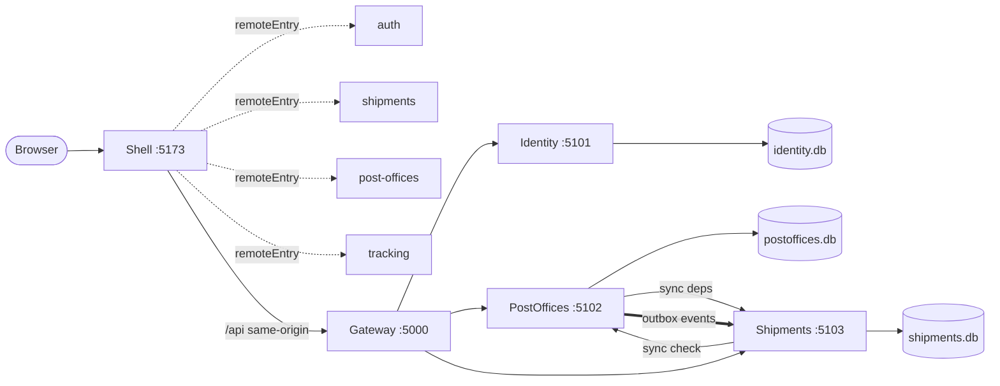

# Post Office Shipment Management System

Staff application for registering, moving and tracking **letters and packages** between post offices (identified by ZIP code). It is built as **.NET 8 microservices** (Clean Architecture + DDD, EF Core on SQLite, database per service), a **YARP API gateway**, and a **React + TypeScript micro-frontend** UI composed with Module Federation.

---

## 1. Project overview

| | |
|---|---|
| Backend | 3 services: **Identity**, **PostOffices**, **Shipments** (incl. tracking), plus **Gateway** |
| Frontend | **Shell** host + 4 remotes: **auth**, **shipments**, **post-offices**, **tracking**, plus the `@postal/shared` library |
| Data | One SQLite file per service; transactional outbox; idempotent inbox |
| Security | RS256 JWT in HttpOnly cookies, rotating refresh tokens, CSRF double-submit, permission-based authorisation |
| Docs | [Architecture & 12 diagrams](docs/architecture/README.md) · [API reference](docs/api/README.md) · [ADRs](docs/decisions) |

## 2. Business requirements (as implemented)

- **Shipments**: Letter or Package; weight in kg (decimal, gram precision, 0 < w ≤ 1000) with categories **< 1 kg**, **1–5 kg inclusive**, **> 5 kg**. Each has a unique generated number `SHP-YYYYMMDD-XXXXXXXX`, origin, destination (may be equal: local delivery), current post office, status, and created/updated dates.
- **Lifecycle**: ReceivedAtOrigin → ProcessedAtOrigin → InTransit → ReceivedAtDestination → ProcessedAtDestination → OutForDelivery → Delivered, plus FailedDeliveryAttempt (retry or hold) and Lost (from any active state). Each status must be recorded at the right office. Delivered and Lost are terminal except through an audited **Administrator correction**.
- **History**: an append-only audit of every change (who, where, when, remarks, correction flag).
- **Post offices**: CRUD, unique ZIP, activate/deactivate. An inactive office accepts no new shipments, and an office cannot be deleted while active shipments reference it.
- **Search**: server-side paging, sorting and combinable filters (number prefix, type, status, origin, destination, current office, weight category, date range) with full paging metadata.
- **Edits and deletes** are allowed only before a shipment is processed at origin.

Assumptions are listed in [§24](#24-known-limitations).

## 3. Technology stack

| Layer | Choice |
|---|---|
| Backend | C# 12, ASP.NET Core 8 (controllers), EF Core 8 + SQLite, FluentValidation 11, Swashbuckle, YARP 2, Microsoft.Extensions.Http.Resilience (Polly 8), OpenTelemetry |
| Auth | Microsoft.IdentityModel (RS256 JWT, JWKS), ASP.NET Core Identity `PasswordHasher` (PBKDF2) |
| Frontend | React 18, TypeScript 5 (strict), Vite 5, `@originjs/vite-plugin-federation`, React Router 6, TanStack Query 5, MUI 6, react-hook-form + zod |
| Tests | xUnit, FluentAssertions 6 (Apache-2.0), Moq, WebApplicationFactory; Vitest + React Testing Library |

## 4. Architecture overview



## 5. High-level architecture diagram
See [docs/architecture §2](docs/architecture/README.md#2-high-level-architecture). It also has the responsibility of each component and the end-to-end request flow.

## 6. Low-level diagrams
[Backend services](docs/architecture/README.md#3-backend-microservices) · [Micro-frontends](docs/architecture/README.md#4-frontend-micro-frontends) · [Clean Architecture](docs/architecture/README.md#5-clean-architecture-layers) · [ER diagrams](docs/architecture/README.md#6-database-entity-relationship-diagrams) · [Create](docs/architecture/README.md#7-shipment-creation-sequence) / [status](docs/architecture/README.md#8-shipment-status-update-sequence) / [tracking](docs/architecture/README.md#9-shipment-tracking-sequence) sequences · [State machine](docs/architecture/README.md#10-shipment-status-state-machine) · [Deployment](docs/architecture/README.md#11-deployment-architecture) · [CAP / failure](docs/architecture/README.md#12-cap-theorem-and-failure-behaviour)

## 7. DDD implementation

| Bounded context | Aggregate root | Value objects | Domain events | Key invariants |
|---|---|---|---|---|
| Shipments | `Shipment` (owns `ShipmentStatusHistory`) | `ShipmentNumber`, `Weight`, `ZipCode` | `ShipmentCreated/Updated/Deleted/StatusChanged` | Transition table, location rule, terminal states, editable only at `ReceivedAtOrigin`, history always in step with the current status |
| PostOffices | `PostOffice` | `ZipCode`, `Address` | `PostOfficeChanged` (Created/Updated/Activated/Deactivated/Deleted) | ZIP immutable, contact format, pending-deletion blocks changes and shipments |
| Identity | `User` (+ `RefreshToken`) | — | — | Lockout after 5 failures, valid roles |

The state machine lives in `ShipmentStatusRules`. Aggregates increment `Version` on each change, and the domain events become integration events through the outbox.

## 8. Clean Architecture implementation
Each service has `Domain` → `Application` → `Infrastructure` → `Api` projects. Domain projects have **no package references**, and the Application layer has no EF Core. `PostalService.ArchitectureTests` verifies the dependency rule and that no service references another.

## 9. Microservices design decisions
Tracking is merged into Shipments because status and history must change atomically ([ADR-0001](docs/decisions/0001-microservices-vs-modular-monolith.md)). Data ownership is strict, with no shared database; communication is chosen per need ([ADR-0005](docs/decisions/0005-cap-theorem-trade-offs.md), [ADR-0007](docs/decisions/0007-event-driven-communication.md), [ADR-0008](docs/decisions/0008-consistency-strategy.md)).

## 10. Micro-frontend design decisions
Module Federation with shared singletons for React, the router, React Query and MUI. Each remote is lazy-loaded behind its own error boundary, the remote URLs are configuration, and no MFE imports another ([ADR-0002](docs/decisions/0002-micro-frontend-integration.md)).

## 11. CAP theorem analysis
**CP**: shipment registration (synchronous check with the post office owner, failing closed with 503), status changes (optimistic concurrency → 409), ZIP uniqueness, the delete saga. **AP**: search, statistics and display names served from local data plus an event-fed replica. Full table and failure behaviour: [ADR-0005](docs/decisions/0005-cap-theorem-trade-offs.md), [diagram 12](docs/architecture/README.md#12-cap-theorem-and-failure-behaviour).

## 12. Database design and SQLite limitations
ER diagrams are in [docs/architecture §6](docs/architecture/README.md#6-database-entity-relationship-diagrams). The design uses WAL mode, busy timeout, integer grams for weight, UTC date converter, a unique index on the shipment number and ZIP, and indexes on every filter column. **SQLite is single-writer and file-local, so each service runs as one instance with no HA.** The migration path to PostgreSQL/SQL Server is in [ADR-0003](docs/decisions/0003-sqlite-database-per-service.md).

## 13. JWT authentication design
RS256 tokens are signed by Identity, and the public key is served as JWKS. Access and refresh tokens live in HttpOnly, Secure, SameSite=Strict cookies. Refresh tokens rotate with reuse detection, writes require a CSRF double-submit token, and services authorise by permission claims ([ADR-0009](docs/decisions/0009-jwt-authentication.md)).

| Role | Can do |
|---|---|
| Administrator | Everything, including status corrections and user management |
| PostOfficeManager | Shipments (incl. delete), post offices (create/edit/activate) |
| ShipmentOperator | Register/edit shipments, record statuses; read post offices |
| ShipmentViewer | Read only |

## 14. API documentation
[docs/api/README.md](docs/api/README.md) lists every endpoint with payloads, status codes, validation, permissions and examples. Swagger UI is at `/swagger` on each service in Development.

## 15. Database migrations
Each service applies EF Core migrations on startup (`Database.Migrate()`). The repository ships **without** generated migration files, because they must be produced by `dotnet ef` against the exact model. Until they exist, startup falls back to `EnsureCreated()` and logs a warning, so the app runs either way. Generate them once:
```bash
cd backend
./scripts/add-migrations.sh          # or: pwsh ./scripts/add-migrations.ps1
```
This creates `Persistence/Migrations` in each Infrastructure project. For later model changes run `./scripts/add-migrations.sh <Name>`. If you ran the app before generating migrations, delete `App_Data/*.db` once so `Migrate()` can own the schema.

## 16. Project structure
```
postal-shipments/
├── backend/
│   ├── PostalService.sln · global.json · Directory.Build.props · Directory.Packages.props
│   ├── scripts/ (add-migrations.sh|ps1, run-all.sh|ps1)
│   ├── src/
│   │   ├── BuildingBlocks/
│   │   │   ├── PostalService.BuildingBlocks.Domain          # AggregateRoot, ZipCode, DomainException
│   │   │   ├── PostalService.BuildingBlocks.Application     # IUnitOfWork, ICurrentUser, paging, roles/permissions
│   │   │   └── PostalService.BuildingBlocks.Infrastructure  # outbox/inbox, ProblemDetails, JWT, CSRF, OTel, SQLite setup
│   │   ├── Services/
│   │   │   ├── Identity/    {Domain, Application, Infrastructure, Api}
│   │   │   ├── PostOffices/ {Domain, Application, Infrastructure, Api}
│   │   │   └── Shipments/   {Domain, Application, Infrastructure, Api}
│   │   └── ApiGateway/PostalService.Gateway                 # YARP
│   └── tests/
│       ├── PostalService.Shipments.UnitTests        # domain + application
│       ├── PostalService.PostOffices.UnitTests      # domain + delete saga
│       ├── PostalService.Identity.UnitTests         # login, lockout, rotation, JWKS
│       ├── PostalService.Shipments.IntegrationTests # WebApplicationFactory + real SQLite
│       └── PostalService.ArchitectureTests          # dependency rule, context isolation
├── frontend/
│   ├── package.json (npm workspaces) · tsconfig.base.json · federation.config.ts
│   ├── packages/shared/   # api client, auth hooks, UI primitives, test utils
│   └── apps/
│       ├── shell/         # host :5173
│       ├── auth/          # remote :5174 — Login, Users
│       ├── shipments/     # remote :5175 — list, form, details, dashboard
│       ├── post-offices/  # remote :5176
│       └── tracking/      # remote :5177
└── docs/
    ├── architecture/README.md   # 12 Mermaid diagrams
    ├── api/README.md
    └── decisions/0001…0009      # ADRs
```

## 17. Prerequisites
- **.NET 8 SDK** (8.0.100+; newer SDKs work through `rollForward`)
- **Node.js 20+** and npm 10
- Optional: VS Code with the C# Dev Kit, or Visual Studio 2022 17.8+

## 18. Installation
```bash
cd backend  && dotnet restore && dotnet tool restore
cd ../frontend && npm install
```

## 19. Configuration
| Setting | Where | Default (Development) |
|---|---|---|
| Service URLs | `appsettings.json` → `Urls` | 5101 / 5102 / 5103, gateway 5000 |
| SQLite files | `ConnectionStrings:*` | `App_Data/<service>.db` |
| JWT issuer/audience/lifetimes | `Jwt` | `postal-identity` / `postal-api` / 15 min / 7 days |
| Signing key | `Jwt:SigningKeyPath` (Identity) | Generated at `App_Data/keys/signing-key.pem` on first run (dev only; **required** in Production) |
| Internal API key | `Internal:ApiKey` | `appsettings.Development.json` (dev only). Set via user-secrets/env in other environments. |
| Seed users | `Seed:Users` | `appsettings.Development.json` (see §20) |
| Outbox subscribers | `Outbox:Subscribers` | PostOffices → `http://localhost:5103/internal/events` |
| Telemetry | `OTEL_EXPORTER_OTLP_ENDPOINT` | Unset (no export) |
| Remote MFE URLs | `VITE_REMOTE_*` | `http://localhost:517x/assets/remoteEntry.js` |
| Gateway for the Vite proxy | `VITE_GATEWAY_URL` | `http://localhost:5000` |

No secret is hard-coded in source. Development-only values live in `appsettings.Development.json`; outside Development use `dotnet user-secrets`, environment variables (`Internal__ApiKey`) or Key Vault.

## 20. Running the backend
```bash
cd backend
./scripts/run-all.sh        # Linux/macOS (Ctrl+C stops all)
pwsh ./scripts/run-all.ps1  # Windows (opens a window per service)
```
Or start each project from VS / VS Code: **Identity first** (the others fetch its JWKS), then PostOffices, Shipments and Gateway.

Development sign-ins:

| User | Password | Role |
|---|---|---|
| admin | Admin@12345! | Administrator |
| manager | Manager@12345! | PostOfficeManager |
| operator | Operator@12345! | ShipmentOperator |
| viewer | Viewer@12345! | ShipmentViewer |

PostOffices seeds five demo offices (500001, 500081, 560001, 400001, 110001). They reach the Shipments replica through the outbox within a few seconds.

## 21. Running the frontend
```bash
cd frontend
npm run dev      # builds the 4 remotes, serves them (5174–5177), starts the shell dev server on 5173
# open http://localhost:5173
```
`npm run start` serves production builds of everything. To work on one remote in isolation: `npm run dev -w @postal/mfe-shipments`, then open http://localhost:5175/shipments (sign in through the shell first; cookies are per host).

### Building and deploying one frontend independently

The npm workspace is also the deployment boundary: build a single app with `npm run build -w <workspace>`. Each app can be packaged as a separate static Nginx image from `frontend/Dockerfile` (`APP_DIR` selects its output). For example:

```bash
cd frontend
docker build -t postal-mfe-shipments \
  --build-arg WORKSPACE=@postal/mfe-shipments \
  --build-arg APP_DIR=apps/shipments .
```

Use the corresponding workspace and directory for `@postal/shell` (`apps/shell`), `@postal/mfe-auth` (`apps/auth`), `@postal/mfe-post-offices` (`apps/post-offices`), or `@postal/mfe-tracking` (`apps/tracking`). Build each image from the same monorepo checkout; only the selected app's Vite build is run. Configure each remote's host independently, then build the shell with the remote entry URLs:

```bash
docker build -t postal-shell \
  --build-arg WORKSPACE=@postal/shell \
  --build-arg APP_DIR=apps/shell \
  --build-arg VITE_REMOTE_AUTH=https://auth.example.com/assets/remoteEntry.js \
  --build-arg VITE_REMOTE_SHIPMENTS=https://shipments.example.com/assets/remoteEntry.js \
  --build-arg VITE_REMOTE_POST_OFFICES=https://post-offices.example.com/assets/remoteEntry.js \
  --build-arg VITE_REMOTE_TRACKING=https://tracking.example.com/assets/remoteEntry.js .
```

The remote images send CORS headers and avoid caching `remoteEntry.js`, so a remote can publish new assets without rebuilding the shell. Configure the production ingress to route `/api/*` to the API gateway and serve the shell at the application URL. Remote URLs are embedded in the shell at build time; rebuilding/redeploying the shell is required when those URLs change.

## 22. Database initialisation
Automatic on service start: migrate (or create), enable WAL, seed dev data. To reset, stop the services and delete `backend/src/Services/*/PostalService.*.Api/App_Data/`.

## 23. Tests
```bash
cd backend  && dotnet test           # unit, integration (SQLite temp files), architecture
cd frontend && npm test              # Vitest + RTL in every workspace
cd frontend && npm run typecheck     # strict TypeScript in every workspace
```

**What was verified while building this deliverable:**

| Area | Result |
|---|---|
| Frontend: 38 tests across 6 workspaces | ✅ all pass |
| Frontend: strict typecheck and production build (shell + 4 remotes) | ✅ pass |
| Frontend: browser smoke test of the federated app in headless Chrome against a mock API (login redirect, dashboard, list, details/status dialog, post offices, tracking, users, new-shipment form) | ✅ all remotes load and render |
| Backend: Domain and shared-kernel projects compile; 46 domain-rule checks (weight boundaries, every transition, location rules, terminal/correction, local delivery, edit lock, saga steps, lockout, role matrix, paging) | ✅ pass |
| Backend: Application, Infrastructure, API, Gateway projects and the xUnit suites (~119 test cases) | ⚠️ **not compiled in the authoring sandbox.** NuGet was not reachable there, so EF Core, JwtBearer, YARP, FluentValidation, Swashbuckle and xUnit could not be restored. Run `dotnet build` and `dotnet test` first and treat any error as a defect to fix. |

## 24. Known limitations
- **SQLite**: single writer, one instance per service, no HA ([ADR-0003](docs/decisions/0003-sqlite-database-per-service.md)).
- **Outbox dispatcher** runs inside the API process and assumes a single instance. Use a separate worker or a broker when scaling.
- **HTTP push** event transport, a local stand-in for a broker.
- **Integration tests** cover Shipments; PostOffices and Identity have unit-level coverage of their critical paths only.
- **Migrations** must be generated once (§15).
- A post office stuck in `PendingDeletion` after a crash needs a manual or periodic cleanup (ADR-0008).
- **Assumptions**: ZIP = 3–10 alphanumerics; max weight 1000 kg; letters and packages share rules; the ZIP is immutable; shipments can be edited or deleted only before processing at origin; "location" filter means the *current* post office, with origin and destination as separate filters.
- **Not done**: API versioning (rationale in [docs/api](docs/api/README.md#conventions)), backend Dockerfiles and CI pipeline, offline scanning. Frontend static-image deployment is documented in §21.

## 25. Future enhancements
1. PostgreSQL/Azure SQL per service + multiple instances (ADR-0003 path).
2. Azure Service Bus transport (sessions per aggregate) + outbox worker deployment.
3. Entra ID federation or a BFF for sessions; per-office data scoping for clerks.
4. Notification service consuming `shipment.status-changed.v1` (SMS/email).
5. Docker Compose, backend Dockerfiles, GitHub Actions/Azure DevOps pipeline with test and coverage gates; Playwright E2E suite.
6. Barcode/handheld scanner UI, bulk scanning, CSV export.
7. Keyset pagination for very deep pages; read replica or search index for the list view.
8. `Roles`/`UserRoles` tables for configurable roles.

## Production recommendations
Run at least two instances of every service behind the gateway on Container Apps or AKS, with a managed database per service (zone-redundant), the signing key in Key Vault, managed identity for secrets, OTLP export to Application Insights or Grafana, alerts on 5xx rate, circuit-breaker state, outbox lag and dead-letters, and WAF plus rate limits at Front Door.

## 26. Design decisions and ADRs

### ADR-0001 — Three services plus a gateway, not one service per noun
The system is intentionally split into Identity, PostOffices, and Shipments (with tracking inside Shipments). This keeps ownership aligned with business invariants while avoiding cross-service writes for every status scan. A YARP gateway sits in front so the public API surface remains stable even as the internal service topology evolves.

### ADR-0002 — Micro-frontends with Vite Module Federation
The shell hosts independently deployable React remotes for auth, shipments, post-offices, and tracking. Module Federation allows each remote to own its build and deployment lifecycle while the shell shares global session concerns such as routing, React Query state, and MUI theming. The contract is intentionally tiny: route-level remote components, no direct remote-to-remote imports.

### ADR-0003 — SQLite, one database file per service
SQLite is accepted for local development and the initial deployment model because it keeps each service fully independent with one owner and one database file. The trade-off is explicit: no HA and no multi-instance writes. The project is designed so the same persistence model can be moved to PostgreSQL or SQL Server later without changing the service boundaries or domain code.

### ADR-0004 — One ShipmentStatusHistory entity instead of History + Movement
The system records shipment movement and status history in one append-only aggregate child. This avoids drift between two tables and keeps the current office/status and their audit record consistent in one commit. If a future requirement adds different event kinds, the model can evolve without splitting the table again.

### ADR-0005 — CAP trade-offs per operation
The design does not treat consistency as a single global setting. Shipments registration and critical status transitions are CP, while reads, filters, and display data are AP. The rationale is practical: a shipment being accepted for a closed office is a real operational error, but a stale institution name in a report is not.

### ADR-0006 — Aggregate repositories; DbContext is the Unit of Work
Application services depend on aggregate-specific repository interfaces and an `IUnitOfWork`, but the actual EF Core `DbContext` provides both implementations. This keeps the application layer free from EF Core while preserving atomic commit semantics for aggregate changes, child entities, idempotency keys, and outbox rows.

### ADR-0007 — Transactional outbox with a swappable transport
The project writes domain events to an outbox in the same transaction as the business change and dispatches them asynchronously. Locally this uses HTTP push with idempotent consumers; in production it can be swapped to Azure Service Bus or another broker without changing the aggregate logic. The outbox removes the dual-write risk that would otherwise produce lost or phantom events.

### ADR-0008 — Consistency strategy across and within services
Business invariants are enforced at the domain boundary, inside a service transaction, and across services via explicit saga patterns. This makes it possible to guarantee uniqueness, edit safety, and delete safety without distributed transactions. The delete-post-office flow is the key example: it commits a pending state before checking dependencies so the system cannot accidentally accept shipments against a disappearing office.

### ADR-0009 — RS256 JWTs in HttpOnly cookies with rotating refresh tokens
The application avoids storing tokens in JavaScript-accessible storage. Access and refresh tokens are sent only via HttpOnly cookies, with a double-submit CSRF token for write operations. This keeps XSS impacts low while still allowing the entire micro-frontend shell to participate in one shared session. Refresh tokens rotate, hash, and replay detection revoke the whole family when needed.

### Decision summary
The architecture is intentionally pragmatic: SQLite for the initial implementation, a Clean Architecture split per service, a gateway, module-federated frontend, transactional outbox for cross-service integration, and an explicit CP/AP balance for every critical flow. Those choices are meant to be real, defendable operational decisions, not just a pattern exercise.


