# Architecture

All diagrams are Mermaid and render on GitHub, Azure DevOps and in VS Code (Markdown Preview Mermaid Support).

## Contents

1. [System context](#1-system-context)
2. [High-level architecture](#2-high-level-architecture)
3. [Backend microservices](#3-backend-microservices)
4. [Frontend micro-frontends](#4-frontend-micro-frontends)
5. [Clean Architecture layers](#5-clean-architecture-layers)
6. [Database ER diagrams](#6-database-entity-relationship-diagrams)
7. [Shipment creation sequence](#7-shipment-creation-sequence)
8. [Shipment status update sequence](#8-shipment-status-update-sequence)
9. [Shipment tracking sequence](#9-shipment-tracking-sequence)
10. [Status state machine](#10-shipment-status-state-machine)
11. [Deployment](#11-deployment-architecture)
12. [CAP theorem and failure behaviour](#12-cap-theorem-and-failure-behaviour)

---

## Service boundaries — the decision

| Requirement candidate | Decision | Why |
|---|---|---|
| Authentication service | **Identity service** | Different change cadence, security-sensitive data, its own store. |
| Post office management | **PostOffices service** | Clear master-data context with its own invariant (unique ZIP). |
| Shipment management | **Shipments service** | Core domain. |
| Shipment tracking | **Merged into Shipments** | Current status and history must change in one transaction. Splitting them creates a distributed transaction for every scan, the hottest path in the system. Tracking stays a separate *read API* (`/api/tracking`) and a separate MFE. |

Three services plus a gateway: enough to show real database-per-service and cross-service consistency, without a service per noun (ADR-0001).

---

## 1. System context

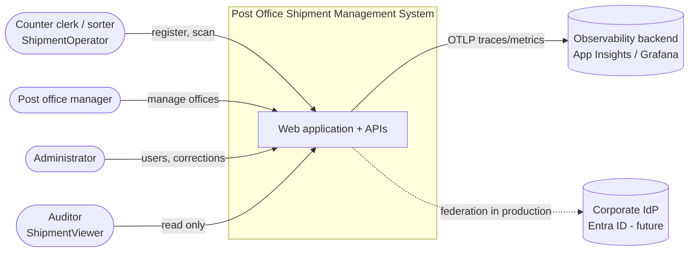

Staff use one web application. Telemetry is exported over OTLP. In production the Identity service would federate to the corporate identity provider rather than store passwords.

## 2. High-level architecture

```mermaid
flowchart TB
    user([Browser])

    subgraph fe[Frontend - Module Federation]
        shell[Shell host :5173<br/>layout, routing, auth guard]
        mAuth[auth MFE :5174<br/>login, users]
        mShip[shipments MFE :5175<br/>list, form, details, dashboard]
        mPo[post-offices MFE :5176]
        mTrack[tracking MFE :5177]
        shell -. remoteEntry.js .-> mAuth & mShip & mPo & mTrack
    end

    gw[API Gateway - YARP :5000<br/>routing, rate limit, CORS,<br/>correlation id, active health checks]

    subgraph be[Backend services]
        id[Identity API :5101<br/>JWT RS256 issuer, JWKS]
        po[PostOffices API :5102]
        sh[Shipments API :5103<br/>shipments + tracking]
    end

    idDb[(identity.db)]
    poDb[(postoffices.db)]
    shDb[(shipments.db)]
    otel[[OpenTelemetry → OTLP]]

    user --> shell
    shell -- "/api/* same-origin, HttpOnly cookies" --> gw
    gw --> id & po & sh
    id --> idDb
    po --> poDb
    sh --> shDb
    po -- "sync: GET /internal/postoffices/{zip}/dependencies" --> sh
    sh -- "sync: GET /internal/postoffices/{zip}" --> po
    po == "async: outbox → POST /internal/events<br/>postoffice.changed.v1" ==> sh
    po & sh -. "JWKS (public key)" .-> id
    id & po & sh & gw -.-> otel
```

**Request flow.** The browser calls `/api/...` on its own origin. The Vite proxy (dev) or the hosting reverse proxy (prod) forwards to the gateway. The gateway routes by path prefix. Each service validates the JWT itself (from the HttpOnly cookie or a bearer header), authorises by permission claim, executes, and returns JSON or RFC 7807 ProblemDetails. The correlation id created at the gateway is echoed back and logged everywhere.

| Component | Responsibility |
|---|---|
| Shell | Owns the layout, top-level routes, the auth guard and the singleton QueryClient. Loads remotes lazily and isolates each behind an error boundary. |
| Remotes | One per bounded context. They expose route-level components only. They never import each other, and they communicate through URLs and window events. |
| Gateway | The single public entry point. It has no business logic and is not trusted for authentication (zero trust). |
| Identity | Login, refresh-token rotation, user/role admin, RSA signing key, JWKS endpoint. |
| PostOffices | Post office master data, unique ZIP, activation, the delete saga. Publishes `postoffice.changed.v1`. |
| Shipments | Shipment aggregate, lifecycle state machine, history, search/filter/paging, statistics, tracking view. Consumes post office events into a local replica. |

## 3. Backend microservices

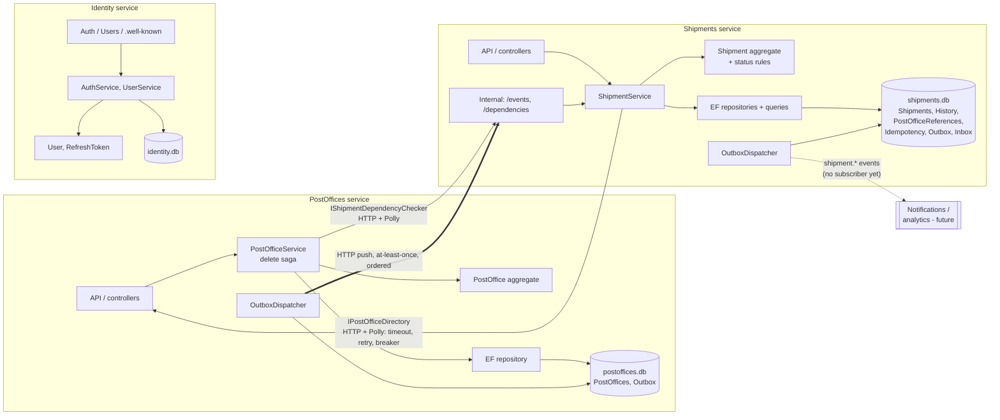

**Communication patterns**

| Interaction | Style | Why |
|---|---|---|
| Shipments → PostOffices: may this ZIP accept shipments? | Synchronous, resilient HTTP | Needs the owner's *current* truth (CP). Fail closed → 503. |
| PostOffices → Shipments: active dependencies for ZIP? | Synchronous, resilient HTTP | Part of the delete saga; must be current. |
| PostOffices → Shipments: names/cities for display and filters | Asynchronous events (outbox) | Staleness is harmless (AP); no runtime coupling. |
| Shipments → others: lifecycle events | Asynchronous events (outbox) | Extension point for notifications or analytics without changing Shipments. |

The transport is HTTP push behind `IIntegrationEventTransport` so the system runs locally without a broker. In production you swap in Azure Service Bus or RabbitMQ (ADR-0007).

## 4. Frontend micro-frontends

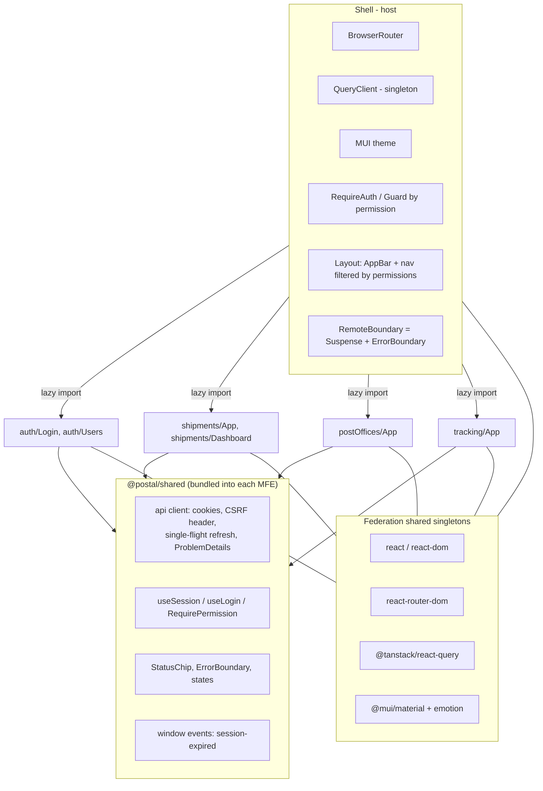

| Concern | Approach |
|---|---|
| Integration | Module Federation (`@originjs/vite-plugin-federation`). Remote URLs come from env vars (`VITE_REMOTE_*`), so each MFE deploys and versions independently. |
| Shared components | `@postal/shared` is a workspace library compiled into each MFE (no runtime coupling). Only stateful libraries are federation singletons. |
| Authentication | HttpOnly `access_token` and `refresh_token` cookies. JS never sees a token, so localStorage has nothing to steal. MFEs share session *state* through the singleton QueryClient (`['session']` → `/api/auth/me`). |
| CSRF | SameSite=Strict cookies plus a double-submit token (`csrf_token` cookie echoed as `X-CSRF-Token`) on every write. |
| Routing | The shell owns top-level paths (`/shipments/*`, ...). Each remote owns relative sub-routes. |
| State | Server state lives in React Query (cache, retries, `keepPreviousData` for paging). Filter state lives in the URL. Form state lives in react-hook-form with zod validation. |
| Errors | One error boundary per remote, ProblemDetails mapped to messages and to field errors, 401 → silent refresh → `session-expired` event → login. |
| Lazy loading | `React.lazy` per remote and per route. |
| Version compatibility | Exposed modules are prop-less route components, a tiny contract. Shared deps are pinned at the workspace root. Breaking changes ship as a new exposed module (`./AppV2`). |
| Isolation | No cross-MFE imports (enforced by structure), window events for cross-cutting signals, and a failing remote renders a fallback while the shell keeps working. |

## 5. Clean Architecture layers

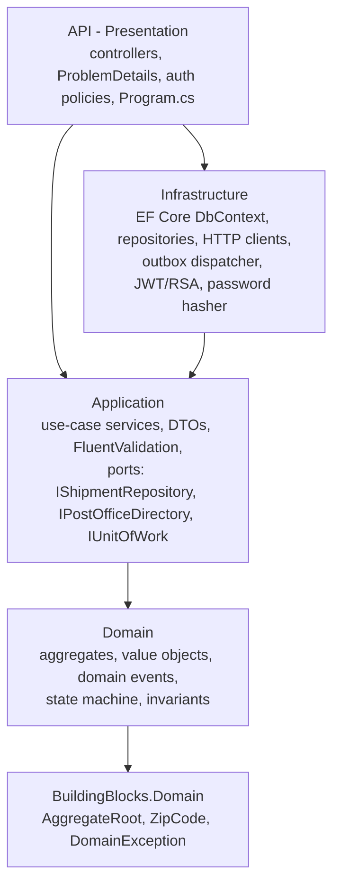

Dependencies point inward only. The Domain has no package references at all, and the Application layer has no EF Core. `tests/PostalService.ArchitectureTests` fails the build if any service breaks this rule or references another service's assemblies.

## 6. Database entity relationship diagrams

Each service owns one SQLite file. No foreign keys cross databases; cross-service references are by business key (ZIP code).

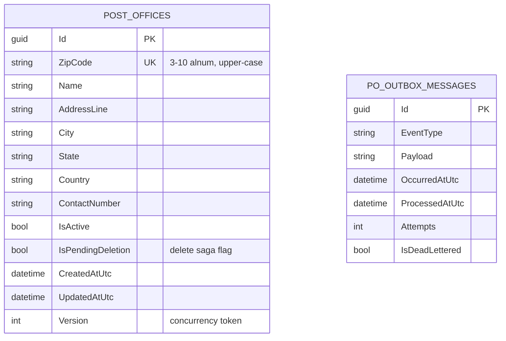

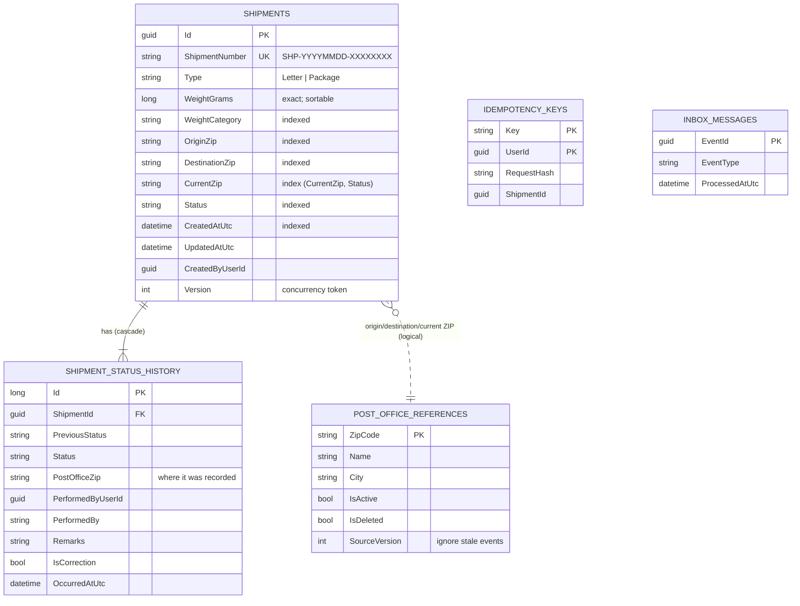

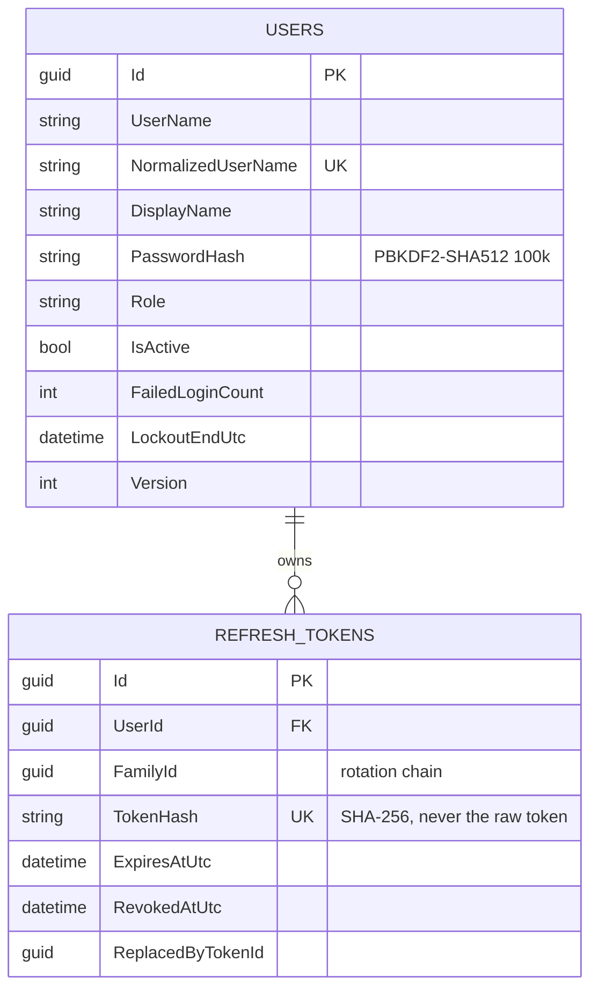

**History vs movement.** There is one entity, `ShipmentStatusHistory`. Every entry records *where* it happened (`PostOfficeZip`), so the movement trail is a projection of the history, and a separate `ShipmentMovement` table would duplicate data and could drift (ADR-0004).

**Roles.** A role is a single column, and permissions derive from the role in code (`RolePermissions`). `Roles` and `UserRoles` tables would add joins without a requirement for user-defined roles; they are a listed future enhancement.

## 7. Shipment creation sequence

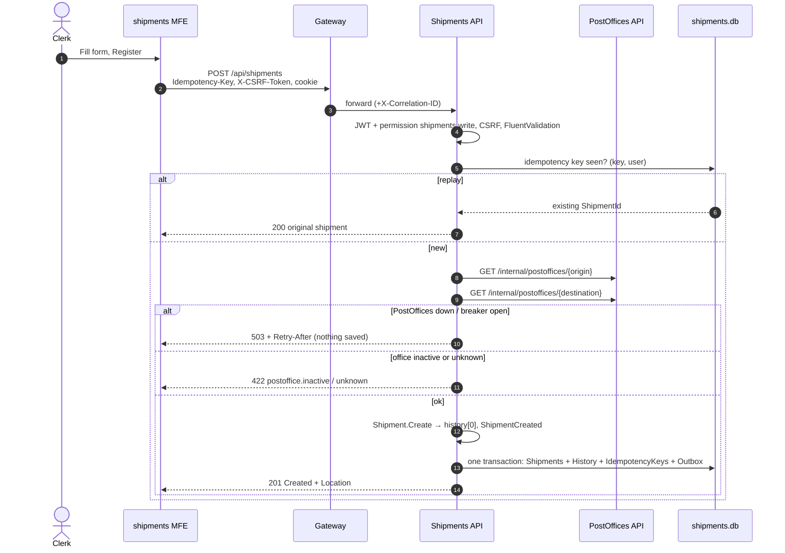

## 8. Shipment status update sequence

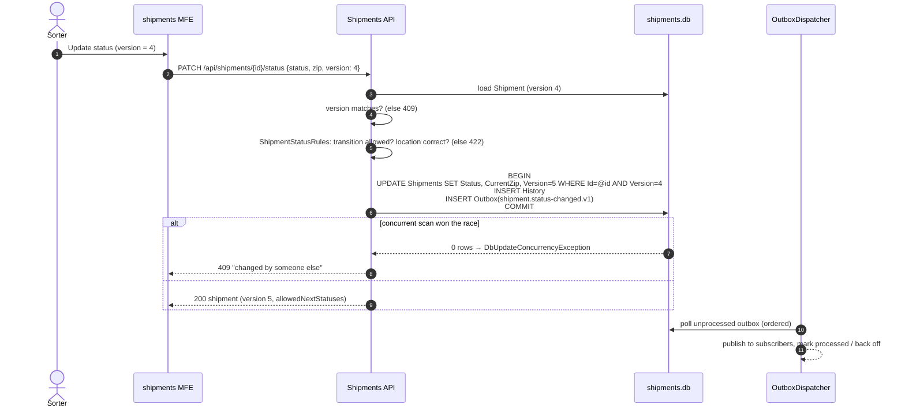

## 9. Shipment tracking sequence

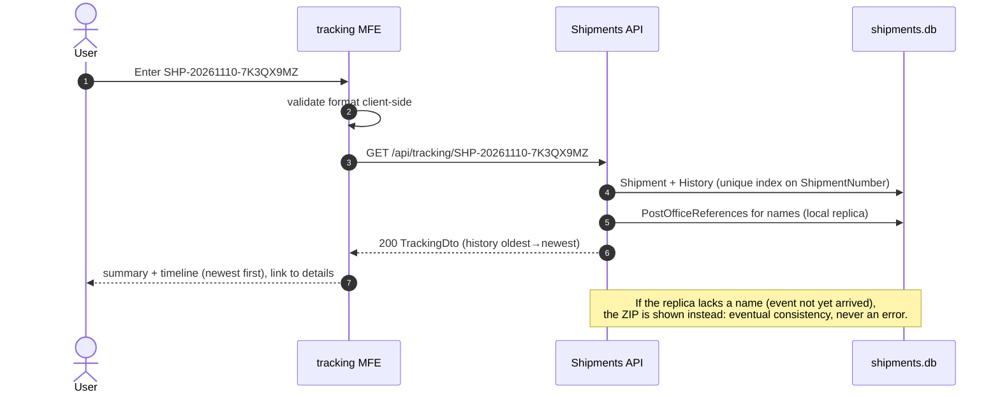

## 10. Shipment status state machine

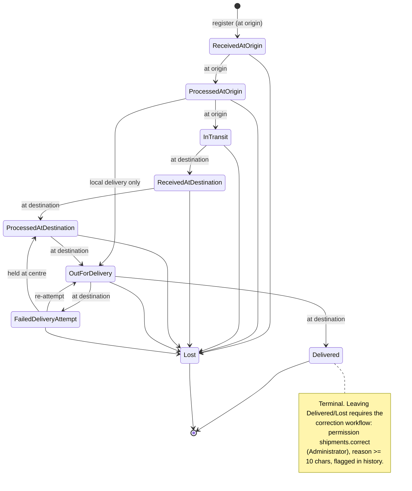

Editing and deleting are allowed only in `ReceivedAtOrigin`.

## 11. Deployment architecture

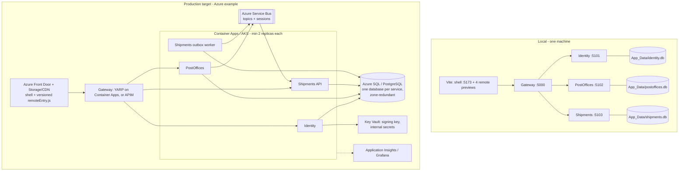

SQLite pins each service to **one instance** with a local volume. That is fine for development and small single-node deployments, but it is not highly available. The production column replaces each SQLite file with a managed database per service, which is the change that allows horizontal scaling (ADR-0003).

## 12. CAP theorem and failure behaviour

When the network partitions, each operation must choose consistency (refuse) or availability (answer, possibly stale). The choice is made per operation, not per system.

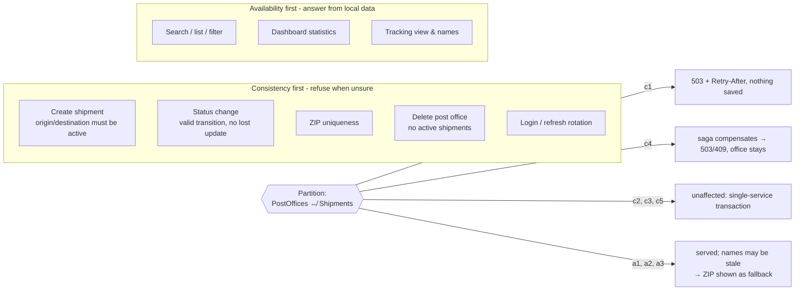

| Operation | Choice | Mechanism | During a partition |
|---|---|---|---|
| Create shipment | **CP** | Synchronous check with the owner + Polly (800 ms attempt, 2 retries, circuit breaker). Unique index on number, idempotency key. | 503 with Retry-After. The client retries safely with the same Idempotency-Key. |
| Status change | **CP** | One aggregate, one local transaction; `Version` optimistic concurrency token. | Unaffected (no remote call). Concurrent scans: one wins, the other gets 409. |
| Current status vs history | **CP** | Same aggregate, same transaction. | Cannot diverge. |
| ZIP uniqueness | **CP** | Unique index in the owning DB. | Unaffected. |
| Inactive office refuses shipments | **CP** | Shipments asks PostOffices synchronously (not the replica). | Fail closed (503). |
| Delete post office | **CP** | Saga: `PendingDeletion` (commit) → dependency check → delete, or compensate. | Compensates and returns 503. |
| Search, statistics, tracking names | **AP** | Local DB plus a replica updated by idempotent, version-checked events. | Served. Names may lag by seconds. |
| Integration events | at-least-once | Transactional outbox, ordered dispatcher, inbox dedupe, DLQ after 10 attempts. | Queued in the outbox and delivered when the link heals. |

**SQLite and P.** Within one SQLite file there is no partition, because it is a single node. The CAP trade-offs above apply between services. When moving to replicated databases, keep the CP operations on the primary or with synchronous replicas, and serve AP reads from read replicas (ADR-0005).
